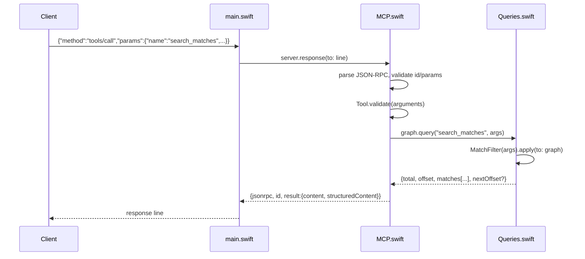

# Flow

On startup `SoccerGraph(directory:)` reads all six CSVs once, canonicalizes team names, merges duplicate fixtures across the five match sources (with a handful of dataset-specific corrections), and indexes matches by team and players by club. Each `tools/call` then validates arguments against a per-tool JSON schema, dispatches to `query(_:args:)`, and returns both a `structuredContent` object and an equivalent JSON text block. Standings, records and analytics are all computed from the merged match set at request time — nothing is hardcoded. Note: argument-level failures are returned as `isError: true` tool results (not JSON-RPC errors), which is MCP-idiomatic; protocol-level failures use JSON-RPC error codes.
