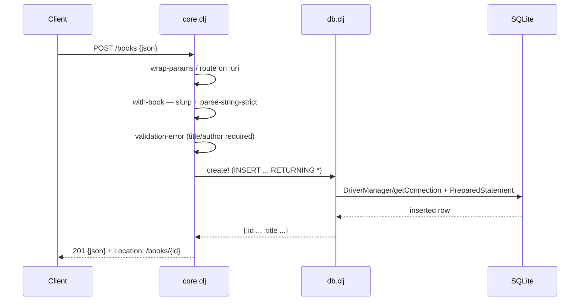

# Flow

A `POST /books` is routed by exact `:uri` match in `make-app`. `with-book` reads the request body, parses it strictly with Cheshire (rejecting malformed JSON as `400`), then runs `validation-error` to enforce that `title`/`author` are nonblank strings and `year`/`isbn` have correct types. On success it selects the four editable keys and calls `db/create!`, which opens a fresh JDBC connection per call and runs a parameterized `INSERT ... RETURNING *`. The created row is JSON-encoded as `201` with a `Location` header. Every handler is wrapped in a `try` that maps an uncaught `SQLException` to `500`. Notable: each DB operation opens and closes its own connection (no pooling); `PUT` is a full replace (omitted optional fields become null); the author filter is exact and case-sensitive.
