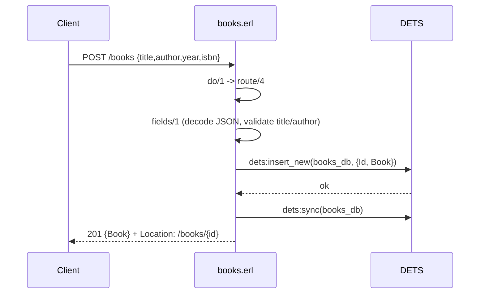

# Flow

`do/1` parses the request URI, dispatches on method + path in `route/4`, and wraps the handler in a try/catch that maps `{invalid, Msg}` throws to 400 and any other exception to a logged 500. `POST /books` runs `fields/1` to JSON-decode the body and reject blank/missing `title`/`author` (and non-integer `year` / non-string `isbn`), generates a random 16-byte hex id, inserts with `dets:insert_new`, syncs to disk, and returns 201 with a `Location` header. Item routes (`/books/{id}`) are serialized with `global:trans` per id. Persistence is DETS (OTP's embedded disk term store), not an in-memory map.
