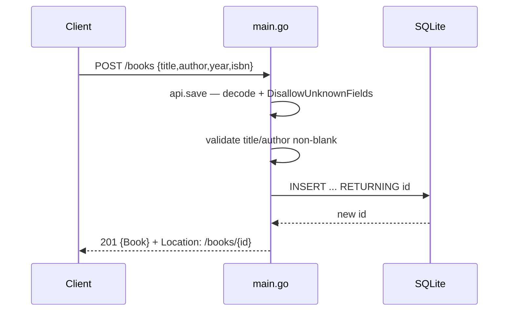

# Flow

A `POST /books` is routed by a single `api.ServeHTTP` dispatcher that switches on `r.URL.Path`. `api.save` decodes exactly one JSON object (rejecting unknown fields and trailing data with 400), trims and validates that `title` and `author` are non-blank, then runs `INSERT ... RETURNING id` against the single-connection SQLite handle and responds 201 with a `Location` header. The same `save` handler serves `PUT` with a non-zero id via `UPDATE ... RETURNING id`, where a missing row surfaces as `sql.ErrNoRows` and is mapped to 404. Error handling is centralized: handlers return an `error`, and the dispatcher maps `sql.ErrNoRows`→404 and any other error→500. No pagination; the `?author=` filter is an exact, case-sensitive SQL equality.
