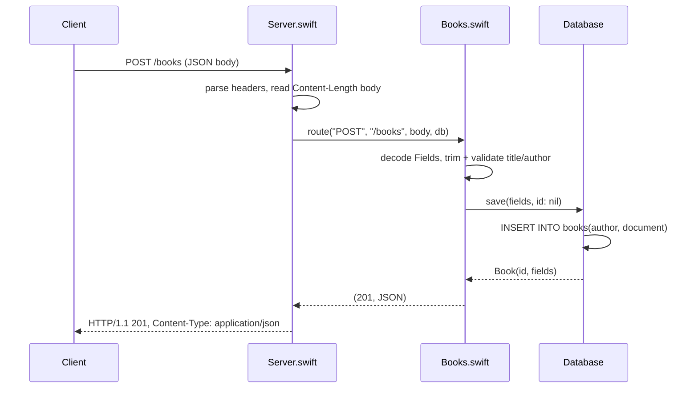

# Flow

A request arrives on an accepted socket; `serve` sets read/write timeouts and calls
`request`, which accumulates bytes until the `\r\n\r\n` header terminator, parses the
request line and `Content-Length`, reads the body, then dispatches to `route`. For a
`POST /books`, `route` JSON-decodes `Fields`, trims and rejects blank title/author (400),
and persists via `Database.save`, which stores the full record as a JSON `document` plus a
denormalized `author` column, returning the autoincrement id. The tuple `(status, Data)`
is framed as a single `Connection: close` HTTP/1.1 response. The server is synchronous and
single-connection-per-accept (one request per connection); errors are mapped to `APIError`
status codes with a JSON `{"error":...}` body.
